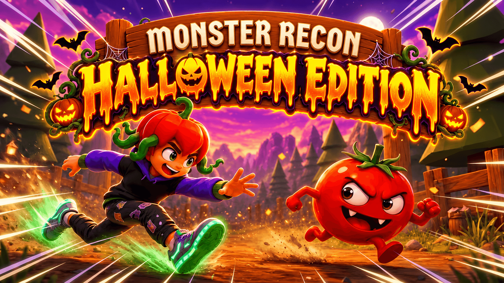

# Monster Recon

<p align="center">
  
</p>

A Decentraland SDK7 scene set in a forest camp overrun by mischievous monsters.

Each of the 20 checkpoints opens with a run of Memory Match boards: flip cards against the clock,
pair them up before the timer runs out, and the boards grow larger and faster as you advance. Clear
a checkpoint and you win a monster — but you still have to catch it. The monster pops up somewhere
in camp and hops to a new spot every few seconds; reach it before your chances run out and it joins
your Monster Codex. Later checkpoints give you less time per hop, so the chase gets tighter the
deeper you go.

The Codex fills up across four rarities — Common, Rare, Exotic and Epic — and every round feeds a
weekly leaderboard that resets every Monday at 10:00 UTC, with weekly rewards for the players who
keep coming back.

The game runs on an authoritative server: progress, scores and the leaderboard are kept server-side,
so the standings are the same for everyone in the camp.

**Deployment target:** World `monsterrecon.dcl.eth`

## Design documents

The design notes live in [`design/`](design) — see the [promo brief](design/promo-brief.md). Level
tuning (board sizes, timers, score multipliers) lives in [`src/checkpoints.json`](src/checkpoints.json).

## Run it

**With the Creator Hub (recommended)**

1. Download this repository.

2. Install the [Creator Hub](https://decentraland.org/download/creator-hub), the official desktop app for creating, previewing, and publishing Decentraland scenes.

3. In the **Scenes** tab, import this scene's root folder.

4. Press **Preview** to explore the scene in Decentraland.

**With the command line**

Inside this scene's root directory run:

```
npm install
npm run start
```

`npm run build` type-checks and bundles the scene, `npm run deploy` publishes it to the World, and
`npm run server-logs` streams the authoritative server's logs.

**With an AI coding assistant**

If you build with an AI coding assistant (Claude Code, Cursor, GitHub Copilot, and others), install the official Decentraland SDK Skills first. They teach your agent verified SDK7 patterns for every topic: scene creation, 3D models, interactivity, UI, multiplayer, deployment, and more.

```
npx skills add decentraland/sdk-skills --all
```

See [Vibe Coding with AI](https://docs.decentraland.org/creator/scenes-sdk7/getting-started/vibe-coding) for the full guide.

## Credits

Board music by [Bensound](https://www.bensound.com) (B. Tissot) — License code: HS2MLQCYO5E1P2XY.
